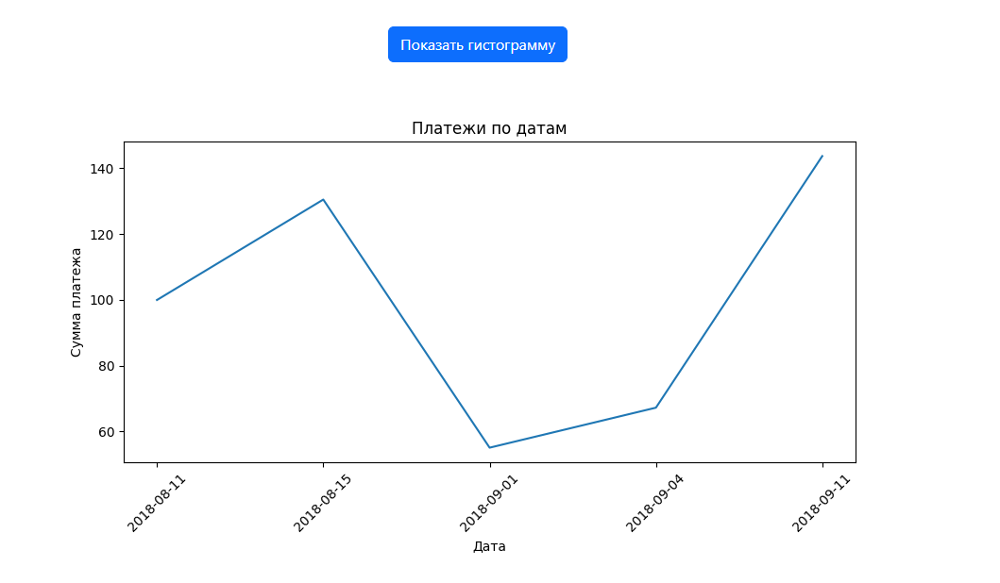
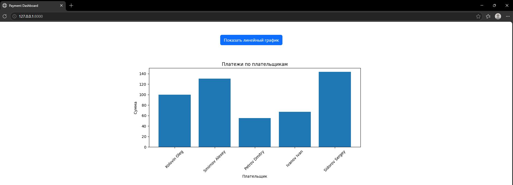
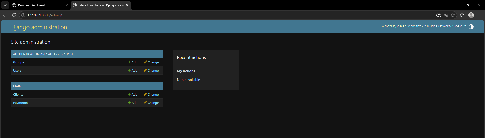

# Тестовое задание для разработчика на языке Python
Выполнил: Усиков Александр, tg: @Chara_XIII, email: AlexanderU250@yandex.ru
## Проект
Одностраничное веб-приложение на Django для визуализации платежей. На главной странице строится линейный график платежей по датам, а по кнопке он меняется на гистограмму с фамилиями и суммами плательщиков.
## Скриншоты
График по датам:  
  
Гистограмма по плательщикам:  
  
Админка:  

## Стек технологий
- Python 3.14
- Django 6.0.5
- PostgreSQL 18
- Bootstrap 5
- matplotlib
## Как это работает
1. В `main/models.py` описаны две модели: `Client` (имя, фамилия, страна) и `Payment` (плательщик, сумма, процент, дата). Платеж связан с клиентом через `ForeignKey`, таблицы называются `clients` и `payments`.
2. Начальные данные лежат в `main/fixtures/initial_data.json` и загружаются командой `loaddata`.
3. По адресу `/` вызывается `payments_data` из `main/views.py`: она получает все платежи вместе с данными клиента и сортирует их по дате.
4. Затем через matplotlib строятся два графика: линейный (дата — сумма) и гистограмма (плательщик — сумма).
5. `main/templates/main/index.html` показывает линейный график, а кнопка на JavaScript скрывает его и показывает гистограмму.
## Инструкция по развертыванию проекта
### Требования
- Python 3.12 +
- PostgreSQL 14 +
## Отчет о проделанной работе
Когда я получил тестовое задание, то сначала начал разобрался, что именно требуется. После этого составил план и начал изучать Django, изучение начал с просмотра этого видеоурока: https://www.youtube.com/watch?v=ifC9rBbfAHo  
Далее начал более детально изучать кк работает Git+GitHub. Отдельно пришлось разобраться в PostgreSQL до этого с ним толком работать не приходилось. Все сопутствующие вопросы изучал с помощью интернета, иногда прибегал к помощи ии, но само задание делал самостоятельно  
Даже если тестовое задание не будет пройдено, благодарю за предоставленный мне опыт.
